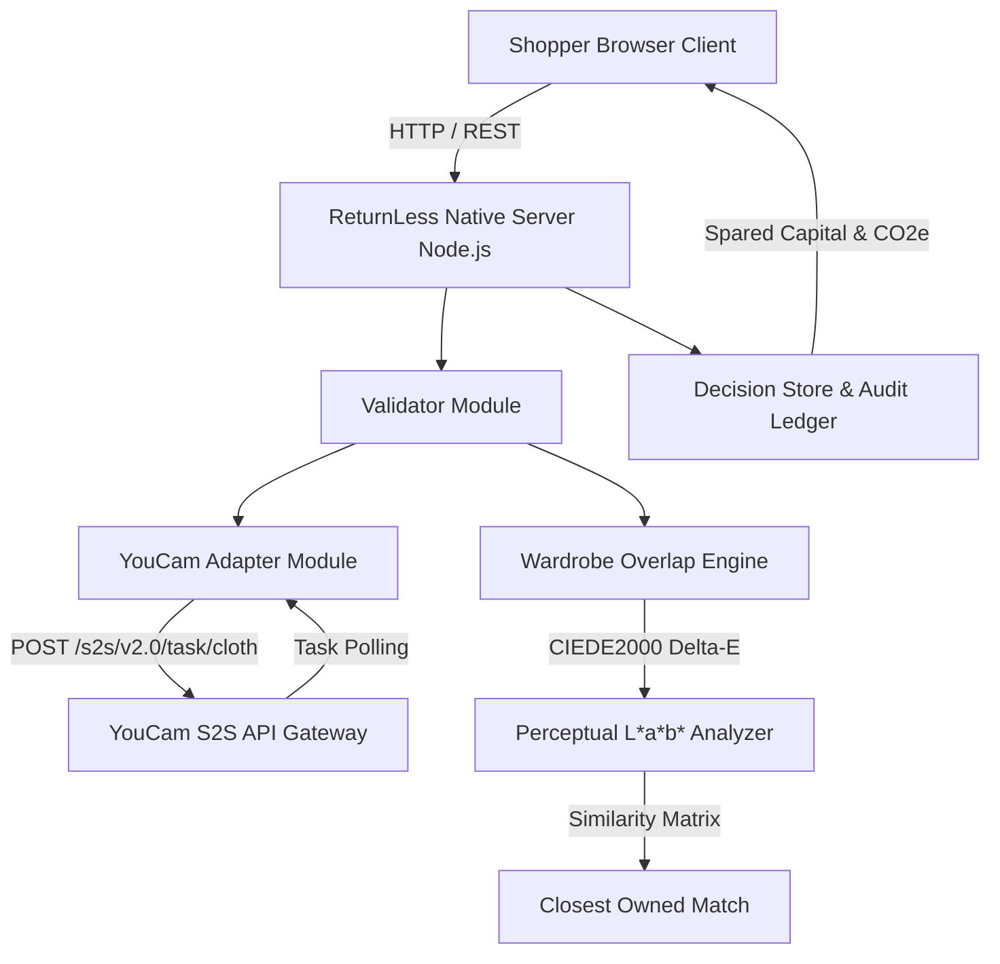

# ReturnLess 🪞

> **Privacy-Conscious Virtual Try-On & Wardrobe Overlap Evidence Engine**  
> Built for the **YouCam API Skin AI & eCommerce Virtual Try-On Hackathon** on Devpost ($6,000 Cash Pool).

[](./test)
[](LICENSE)
[](https://yce.makeupar.com/ai-api)

---

## 1. Executive Summary

Apparel e-commerce faces a **30-40% return rate**, driven heavily by wardrobe duplication ("impulse buying items nearly identical to what one already owns") and uncertain fit.

Most virtual try-on demos stop at rendering a garment on a 2D silhouette. **ReturnLess turns the virtual try-on into an evidence-based purchase decision**:
1. **YouCam S2S Virtual Try-On**: Securely generates realistic clothing drapes fitted directly to the shopper's model via server-to-server calls to Perfect Corp's YouCam API without exposing API credentials to the browser.
2. **Deterministic Wardrobe Overlap Engine**: Evaluates perceptual color distance (CIEDE2000 L\*a\*b\* Delta-E), category utility, and seasonality against the shopper's registered wardrobe.
3. **Evidence-Driven Decision Cockpit**: Renders explicit overlap badges (`REDUNDANT`, `BORDERLINE`, `DISTINCTIVE`), side-by-side color swatches against the closest owned item, and calculates spared capital and avoided reverse-logistics $\text{CO}_2\text{e}$ emissions.
4. **Tamper-Evident Audit Ledger**: Logs keep/reject decisions with explicit shopper rationales, exportable as JSON.

---

## 2. System Architecture



---

## 3. Key Modules & Implementation

- [`src/youcam_adapter.mjs`](file:///d:/distro/returnless/src/youcam_adapter.mjs):
  - Communicates with YouCam S2S Apparel Try-On API (`https://yce-api-01.makeupar.com/s2s/v2.0/task/cloth`).
  - Supports Bearer token authentication via `YOUCAM_API_KEY`.
  - Implements bounded polling loop with timeout guards.
  - Features deterministic offline simulation fixture mode for local automated testing and CI.
- [`src/wardrobe_overlap.mjs`](file:///d:/distro/returnless/src/wardrobe_overlap.mjs):
  - Converts RGB to D65 CIELAB color space.
  - Implements Delta-E color distance mapping and human perceptual decay.
  - Categorizes overlap into `REDUNDANT` ($\ge 75\%$), `BORDERLINE` ($50-74\%$), and `DISTINCTIVE` ($< 50\%$).
- [`src/validator.mjs`](file:///d:/distro/returnless/src/validator.mjs):
  - Strict input validation on image sizes (max 5 MB), safe URL schemes, and supported garment categories (`upper_body`, `lower_body`, `full_body`, `outer`, `shoes`).
- [`src/decision_store.mjs`](file:///d:/distro/returnless/src/decision_store.mjs):
  - Tracks evaluated candidate items, user keep/reject actions, and cumulative spared spending.
- [`src/server.mjs`](file:///d:/distro/returnless/src/server.mjs):
  - Zero external npm dependency HTTP server with REST endpoints.

---

## 4. Verification & Test Suite

All 23 automated tests run via the native Node.js test runner:

```bash
npm test
```

### Test Suite Output:
```
▶ ReturnLess Server E2E Endpoints
  ✔ GET /api/health returns system status
  ✔ GET /api/fixtures returns sample test fixtures
  ✔ POST /api/tryon and GET /api/tryon/:taskId lifecycle
  ✔ POST /api/analyze-overlap produces deterministic verdict
  ✔ POST /api/decision and GET /api/audit-log lifecycle
✔ ReturnLess Server E2E Endpoints

▶ Validator Module
  ✔ validates legitimate image URLs
  ✔ validates SVG and data URIs
  ✔ rejects empty or invalid image sources
  ✔ validates complete try-on payloads
  ✔ rejects unsupported garment categories
  ✔ validates apparel items with default fallbacks
  ✔ validates Keep and Reject decisions
✔ Validator Module

▶ Wardrobe Overlap Analyzer Engine
  ✔ correctly converts Hex to RGB
  ✔ calculates Delta-E = 0 for identical colors
  ✔ calculates high Delta-E for opposing colors
  ✔ determines category overlap properly
  ✔ identifies Redundant garment (Navy Sweater vs Owned Navy Knit)
  ✔ identifies Borderline garment (Heather Slate Cardigan vs Wardrobe)
  ✔ identifies Distinctive garment (Sunset Ochre vs Neutral Wardrobe)
  ✔ handles empty wardrobe gracefully
✔ Wardrobe Overlap Analyzer Engine

▶ YouCam Adapter Module
  ✔ reports simulation mode when API key is empty
  ✔ creates simulated task and transitions to success upon polling
  ✔ rejects missing userImage or garmentImage
✔ YouCam Adapter Module

ℹ tests 23 | pass 23 | fail 0 | duration_ms 1427.55
```

---

## 5. Privacy & Ethical Guardrails

1. **Zero Biometric Storage**: No facial landmark vectors, body dimensions, or biometric identifiers are persisted or shared.
2. **Ephemeral S2S Processing**: Shopper photographs are used solely for real-time try-on rendering and immediately discarded from memory.
3. **No Speculative Fit Claims**: ReturnLess does not guess sizing or body fit; it measures verifiable color and utility overlap against clothing already owned.

---

## 6. License

MIT License. Copyright &copy; 2026 Siddharth Srivastava.
